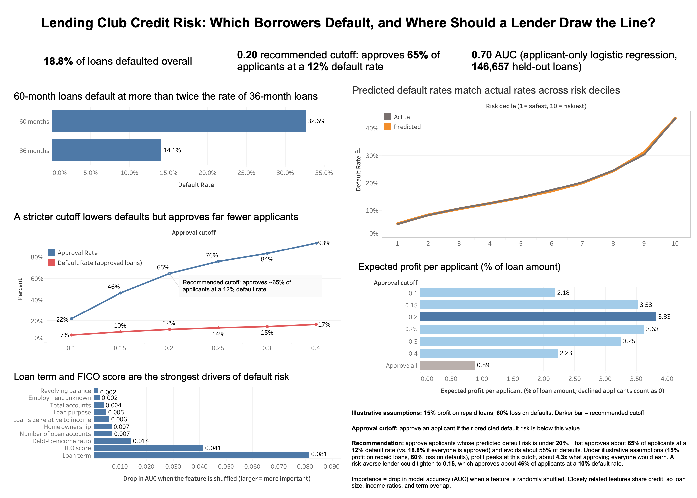
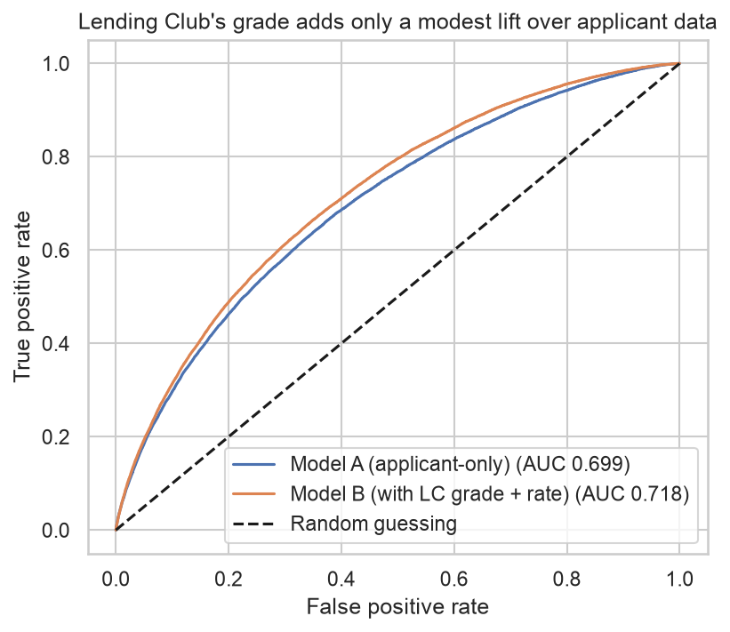

# Lending Club Credit Risk: Predicting Default and Setting an Approval Cutoff

I built an end-to-end credit risk analysis on 733,283 Lending Club loans to
answer two questions: **which borrowers are most likely to default, and where
should a lender draw the approval line?** The project covers SQL exploration
and cleaning, feature engineering, three predictive models, and a profit-based
recommendation, summarized in a Tableau dashboard.



## Key findings

- **Longer loans are riskier.** 60-month loans defaulted at 32.6% vs. 14.1%
  for 36-month loans.
- **Default rates rose each year**, from 15.6% (2013) to 20.2% (2015), and the
  trend holds for 36-month loans alone (12.3% to 14.9%).
- **Loan term and FICO score were the strongest drivers** of default risk.
- **A simple, explainable model works well.** A logistic regression using only
  applicant data reached an ROC AUC of 0.699, versus 0.718 when Lending Club's
  own grade and rate are added.
- **The scores are well calibrated.** Predicted and actual default rates
  matched within about a point across risk deciles; the riskiest decile
  defaulted 8.7x as often as the safest.

## Recommendation

Approve applicants whose predicted default risk is under **20%**.

| Cutoff | Approved | Default rate of approved | Defaults avoided | Profit* |
|---|---|---|---|---|
| 0.10 | 22.2% | 6.9% | 91.8% | 2.18 |
| 0.15 | 46.5% | 9.9% | 75.6% | 3.53 |
| **0.20** | **64.8%** | **12.1%** | **58.3%** | **3.83** |
| 0.25 | 76.1% | 13.6% | 44.9% | 3.63 |
| 0.30 | 83.6% | 14.8% | 34.2% | 3.25 |
| 0.40 | 93.4% | 16.8% | 16.5% | 2.23 |
| Approve all | 100% | 18.8% | 0% | 0.89 |

*Profit per applicant as a % of loan amount, assuming 15% profit on repaid
loans and 60% loss on defaults. These are illustrative assumptions, not Lending
Club's real economics. Profit peaks at the 0.20 cutoff, which matches the
break-even default rate (0.15 / (0.15 + 0.60) = 20%), about 4.3x what approving
everyone earns.

## Models

| Model | ROC AUC | PR AUC |
|---|---|---|
| Logistic regression, applicant-only (main model) | 0.699 | 0.356 |
| Logistic regression + Lending Club grade and rate | 0.718 | 0.370 |
| Gradient boosting, applicant-only | 0.709 | 0.365 |

I used the applicant-only logistic regression as the main model because it is
explainable and gives up little accuracy compared to the more complex model.



## Decisions worth noting

- **Data leakage caught and fixed.** An early payment-to-income feature used
  the loan installment, which embeds Lending Club's interest rate. I replaced
  it with a version using a fixed assumed rate so the applicant-only model is
  genuinely applicant-only.
- **Lending Club's own grade and rate were excluded from the main model**
  because they are the company's existing risk assessment. I used them only in
  a benchmark model.
- **State was left out** because location can act as a proxy for protected
  characteristics, a fair-lending concern.
- **Loans still being repaid were excluded**, so default rates for later and
  longer-term loans may be overstated.

## Data

Lending Club accepted loans, 2013-2015 issue dates, from the
[Kaggle upload](https://www.kaggle.com/wordsforthewise/lending-club).
Only loans with a resolved outcome (Fully Paid, Charged Off, or Default) were
kept. "Charged Off" and "Default" count as default. The raw data is not
included in this repo.

## How to reproduce

1. Download the accepted-loans file from the Kaggle link above and place it in
   `data/archive/`.
2. Set up the environment:
```bash
   python3 -m venv venv
   source venv/bin/activate
   pip install -r requirements.txt
```
3. Build the filtered dataset and database:
```bash
   python src/filter_data.py
   python src/load_to_sqlite.py
```
4. Run the notebooks in order:
   `notebooks/01_sql_exploration.ipynb`, `02_eda_and_features.ipynb`,
   `03_modeling.ipynb`.

## Repository structure

```
notebooks/   analysis notebooks, run in order
sql/         saved SQL queries
src/         data filtering and database loading scripts
reports/     summary, cleaning log, figures, dashboard data
```

## Limitations and next steps

- Only approved loans are in the data, so the model can't speak to applicants
  who were rejected (selection bias).
- The cutoff was chosen on the same test set used to evaluate the model.
- Default rates rose over time, so a model trained on past loans may be less
  accurate on future ones. Next step: train on 2013-2014 and test on 2015.
- Next steps also include fairness checks and a validation-set threshold choice.

**Tools:** Python (pandas, scikit-learn), SQL (SQLite), Tableau, Git.